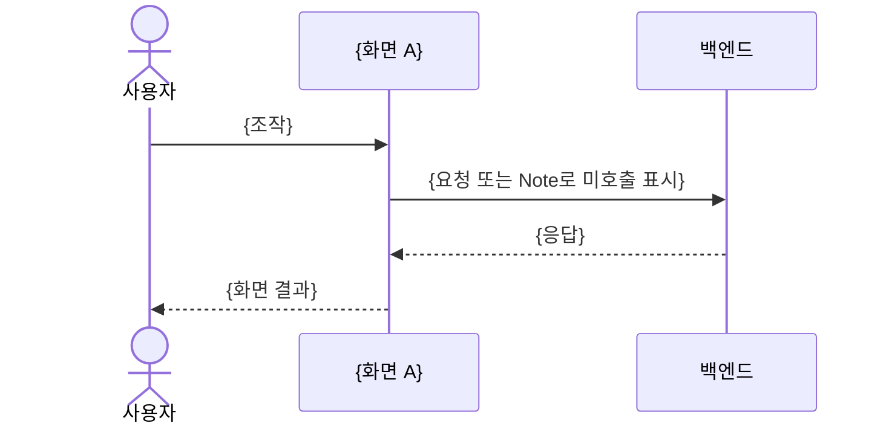

# 테스트케이스 양식 (상세 TC)

> **SSOT:** 이 파일 (`test-case/references/template-detailed.md`)  
> 상세 TC 작성: `test-case` 스킬 · 시나리오 선행: `test-scenario` 스킬 (`TS-*`당 파일 1개, 케이스 표에서 `TC-*` 펼침)

한 파일에 여러 TC를 넣을 때는 TC마다 아래 골격을 반복하고 사이에 `---`를 둔다.

## TC 내용 순서 (10절, 고정)

1. 기본 식별 및 관리 정보
2. 사전 조건
3. 테스트 입력 데이터
4. 시퀀스 다이어그램
5. 시퀀스 다이어그램 기준 흐름
6. 검증 로직
7. 테스트 수행 절차
8. 예상 결과
9. 실제 결과 및 판정 (비움)
10. 참조 API

---

## TC-{DOMAIN}-{FEATURE}-{순번} {제목 — 누가 / 무엇 / 조건 / 검증}

### 1. 기본 식별 및 관리 정보

| 항목 | 내용 |
|------|------|
| 테스트케이스 ID | `TC-{DOMAIN}-{FEATURE}-{순번}` |
| 테스트 항목 / 제목 | {누가} {무엇을} {어떤 조건에서} {무엇을 검증} |
| 테스트 모듈 / 화면 | {도메인·화면·라우트} |
| 첫 진입 URL | {로컬 기준 대표 URL 1개, 예: `http://localhost:3000/login`} |
| 시나리오 원본 | {`docs/test-case/*_SCENARIO.md` 링크·`TS-*` ID — 없으면 생략} |
| 작성자 / 작성일 | |

### 2. 사전 조건

| 항목 | 내용 |
|------|------|
| 권한 | {역할} 계정으로 로그인된 상태여야 한다. (RBAC 적용) |
| 상태 | {진입 화면·데이터 상태} (State Transition 적용) |
| 기타 | |

### 3. 테스트 입력 데이터

| 항목 | 내용 |
|------|------|
| 테스트 입력 데이터 | {필드}: {값} ({정상 값 \| 경계값 \| 경계값 초과 등}) |

### 4. 시퀀스 다이어그램

이 TC가 검증하는 경로만. Happy/Bad/Exception을 한 그림에 섞지 않는다.

### 5. 시퀀스 다이어그램 기준 흐름

| 순서 | 화면/주체 | 사용자 행동 | 화면 반응 |
|------|-----------|-------------|-----------|
| 1 | | | |

(설명용. 테스트 수행 절차와 중복 최소화.)

### 6. 검증 로직

| 대상 | 값/조건 | 확인 방법 |
|------|---------|-----------|
| | | |

(무엇을·어떤 값으로·어떻게 확인하는지. BVA·EP 대표값은 여기 또는 제목에 요약.)

### 7. 테스트 수행 절차

| 순서 | 수행 절차 | 확인 포인트 |
|------|-----------|-------------|
| 1 | {조작}. (인터랙션: {확인할 UI 반응}) | |

### 8. 예상 결과

| 항목 | 기대 결과 |
|------|-----------|
| 인터랙션 및 UI 반응 | {스피너, 팝업, 연타 방지 등} |
| 경계값 및 예외 처리 | {제한과 에러 메시지} |
| 데이터 정합성 | {저장 여부, 기존 값 유지} |

### 9. 실제 결과 및 판정

| 항목 | 실제 결과 | 판정 |
|------|-----------|------|
| | | [ ] Pass / [ ] Fail |

**(실행 전 작성 시 판정·실제 결과는 비움. 에이전트가 채우지 않음.)**

### 10. 참조 API

| 메서드 | API | 요청값 | 호출 타이밍 |
|--------|-----|--------|-------------|
| | | | |

(연동 API 없으면 `해당 없음`.)

---

## 칸 채우는 요령

| 칸 | 넣을 것 |
|----|---------|
| ID | `TC-PROF-UPDATE-003`처럼 `TC-도메인-행위-순번` |
| 제목 | 누가 / 무엇 / 조건 / 검증 포인트가 한 문장에 보이게 |
| 첫 진입 URL | 로컬 기준 대표 경로 1개. 변형이 많으면 보조 경로는 비고에만 |
| 권한 | 역할 + `(RBAC 적용)` |
| 상태 | 진입 화면(또는 데이터 상태) + `(State Transition 적용)` |
| 데이터 | 동등 분할·경계값에서 고른 대표값. 파일이면 용량과 제한 기준 |
| 시퀀스 | participant는 `로그인 화면`처럼 실제 화면명. 프론트 검증에서 막히면 API 미호출을 Note로 |
| 흐름 표 | 다이어그램 화살표 1:1 대응. 절차와 같은 내용 반복 금지 |
| 절차 | 화면에서 누르는 순서. 반응이 있으면 `(인터랙션: …)` |
| 예상 결과 | 인터랙션·UI / 경계·예외 / 데이터 정합성 |
| 실제 결과·판정 | **비워 둔다** |
| 참조 API | 메서드·path·요청값·이 TC에서 호출되는 타이밍 |

## 하지 말 것

- 다른 목차(체크리스트, 성공/실패만 있는 표)로 바꿔 쓰지 않는다
- 양식 10절을 합치거나 빼지 않는다
- **9번** 판정을 에이전트가 채우지 않는다
- 시퀀스 다이어그램 칸을 빼거나, 이 TC와 무관한 전체 시스템 그림을 넣지 않는다
- `Test Steps`를 표 셀 안에 ` `로 넣지 않는다 — 실제 줄바꿈 또는 번호 목록만
- 양식을 `docs/test-case/TEMPLATE.md`로 복사·시드하지 않는다 (이 스킬 references가 SSOT)