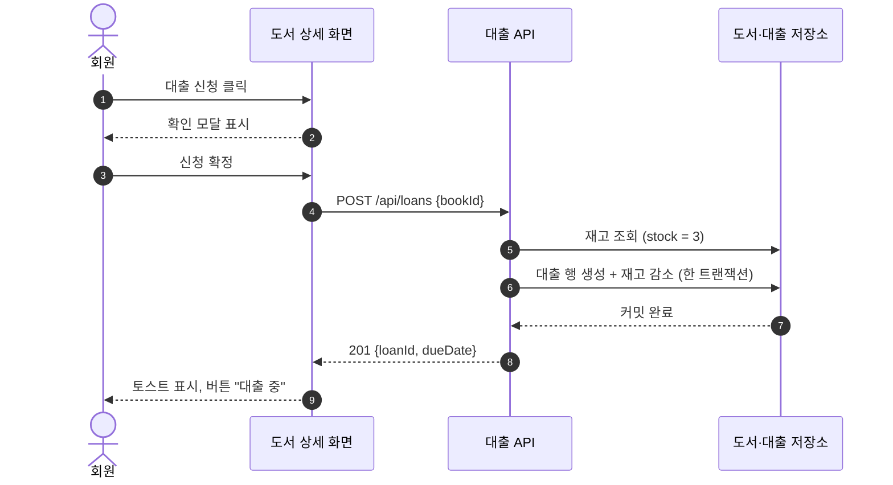

# 작성 예시 — 도서 대출 신청 (가상 서비스, TC 1개 · 10개 항목)

> 가상의 일반 서비스 "온라인 도서관"의 시나리오 1개에서 TC 1개를 [template.md](template.md) 양식으로 채운 예시다.  
> 실제 산출 파일명: `docs/test-case/20261127_153000_LIBRARY_LOAN_SCENARIO_FULL.md`  
> 아래 `---` 이후가 파일 본문이다. 기준 SHA·근거 파일·API 경로는 모두 가상이다.

---

기준 SHA: `a1b2c3d`

# TS-LIB-LOAN-001 · 회원이 도서를 검색해 대출 신청을 완료한다

> 파일명: `docs/test-case/20261127_153000_LIBRARY_LOAN_SCENARIO_FULL.md`  
> **실행하지 않은 문서다.** 판정 칸은 비어 있다. 실행하는 사람이 채운다.

## 시나리오 정보

| 항목 | 내용 |
|------|------|
| 시나리오 ID | `TS-LIB-LOAN-001` |
| 목적 | 로그인한 회원이 대출 가능한 도서를 신청하면 대출 내역에 남고 재고가 줄어든다. |
| 흐름 | 도서 상세 진입 → `대출 신청` 클릭 → 확인 모달 승인 → 대출 완료 토스트·내 대출 목록 반영 |
| 우선순위 | P1 |
| 작성일 | 2026-11-27 |
| 근거 | 도서 상세 화면·대출 API 코드·기획 문서 읽기. **아직 실행하지 않았다.** 연체 정책 상세는 기획 미대조. |
| 앞 시나리오 | `20261127_153000_LIBRARY_SEARCH_SCENARIO_FULL.md` |
| 이어지는 시나리오 | `20261127_153000_LIBRARY_RETURN_SCENARIO_FULL.md` |

## 실행 전 준비

| 항목 | 내용 |
|------|------|
| 환경 | 로컬 / test. 운영계 실행 금지 |
| 계정 | 일반 회원 1개 (대출 0건) |
| 데이터 | 재고 3권 도서 1건 |
| 데이터 변경 | 대출 내역·재고가 바뀐다. 실행 후 테스트 데이터 초기화 |

## 구조

```
TS-LIB-LOAN-001   회원이 도서를 검색해 대출 신청을 완료한다
└─ TC-LOAN-APPLY-001   재고 있는 도서를 대출 신청하면 완료된다
```

## 먼저 볼 케이스

| TC | 코드·문서에서 보이는 것 |
|----|-------------------------|
| `TC-LOAN-APPLY-001` | 신청 성공 후 토스트 문구가 기획과 다를 수 있음 `[확인 필요]` |

---

## TC-LOAN-APPLY-001 · 일반 회원이 재고 있는 도서를 신청하면 대출이 완료된다

### 1. 기본 식별 정보

| 항목 | 내용 |
|------|------|
| TC ID | `TC-LOAN-APPLY-001` |
| 시나리오 원본 TS | `TS-LIB-LOAN-001` |
| 유형 | 정상 |
| 우선순위 | P1 |

### 2. 사전 조건

- 권한: 일반 회원(대출 0건) 계정으로 로그인된 상태
- 진입 상태: 재고 3권 도서의 상세 화면(`/books/{id}`)에 있다.
- 데이터 상태: 해당 회원의 활성 대출 0건, 도서 재고 3권

### 3. 테스트 입력 데이터

| 필드 | 값 | 구분 |
|------|----|------|
| 도서 | 재고 3권 도서 (`BOOK-A`) | 정상 값 |
| 대출 기간 | 기본값 14일 (화면 입력 없음) | 정상 값 |

### 4. 시퀀스 다이어그램



### 5. 시퀀스 다이어그램 기준 흐름표

| 번호 | 발신 | 수신 | 메시지 | 확인할 상태 |
|------|------|------|--------|-------------|
| 1 | 회원 | 도서 상세 화면 | 대출 신청 클릭 | 확인 모달이 열린다 |
| 2 | 도서 상세 화면 | 회원 | 확인 모달 표시 | 모달에 도서명·기간 14일 표시 |
| 3 | 회원 | 도서 상세 화면 | 신청 확정 | 요청이 한 번만 나간다 |
| 4 | 도서 상세 화면 | 대출 API | POST /api/loans {bookId} | 요청 본문에 `bookId`만 있다 |
| 5 | 대출 API | 도서·대출 저장소 | 재고 조회 (stock = 3) | 조회 값이 신청 전 재고와 같다 |
| 6 | 대출 API | 도서·대출 저장소 | 대출 행 생성 + 재고 감소 | 두 변경이 함께 커밋된다 |
| 7 | 도서·대출 저장소 | 대출 API | 커밋 완료 | 오류 없이 종료 |
| 8 | 대출 API | 도서 상세 화면 | 201 {loanId, dueDate} | 응답에 `loanId`·`dueDate`가 있다 |
| 9 | 도서 상세 화면 | 회원 | 토스트 표시, 버튼 "대출 중" | 토스트·버튼 라벨이 바뀐다 |

### 6. 검증 로직

| 번호 | 관찰 지점 | 검증 규칙 | 불충족 시 의미 |
|------|-----------|-----------|----------------|
| V1 | 대출 API 응답 | 상태 코드 = 201 이고 `loanId`가 존재 | 대출 생성 실패 또는 응답 누락 |
| V2 | 대출 저장소 | `user_id`·`book_id`가 일치하는 `ACTIVE` 행이 신규 1건 | 중복 생성 또는 누락 |
| V3 | 도서 재고 | 신청 후 재고 = 신청 전 재고 − 1 (3 → 2) | 재고 정합성 깨짐 |
| V4 | 반납 예정일 | `dueDate` − 신청일 = 14일 | 대출 기간 규칙 위반 |
| V5 | 화면 | 토스트 "대출이 완료되었습니다" 표시, 버튼 라벨 "대출 중" | 완료 피드백 누락 |

판정 규칙: V1–V5가 모두 충족되면 실행자가 Pass 후보로 기록한다. 하나라도 불충족이면 Fail 후보다. 판정 자체는 실행자가 한다.

토스트 문구는 기획 미확정이라 V5의 문구 비교는 `[확인 필요]`다.

### 7. 테스트 수행 절차

1. 재고 3권 도서의 상세 화면을 연다.
2. `대출 신청`을 누른다.
3. 확인 모달에서 `신청`을 누른다.
4. 토스트와 버튼 라벨을 확인한다.
5. `내 대출` 화면으로 이동해 목록을 확인한다.

### 8. 예상 결과

6항목 규칙을 모두 충족했을 때의 최종 상태:

- 화면: 버튼 라벨 `대출 중`, 토스트 "대출이 완료되었습니다" (문구 `[확인 필요]`). `내 대출` 목록에 해당 도서 1건.
- 데이터: 활성 대출 1건, 반납 예정일 = 신청일 + 14일, 도서 재고 2권.
- 그 밖: 해당 없음

### 9. 실제 결과 및 판정

| 실제 결과 | 판정 |
|-----------|------|
| | |

(실행 전 문서 — 비움. 실행하는 사람이 채운다.)

### 10. 참조 API

| 메서드 | 경로 | 요청 | 성공 응답 | 근거 |
|--------|------|------|-----------|------|
| POST | `/api/loans` | `{bookId}` | 201 `{loanId, dueDate}` | `src/api/loans` 30–60줄 (가상) |
| GET | `/api/books/{id}` | 경로 `id` | 200 `{title, stock}` | `src/api/books` 10–25줄 (가상) |

---

## 근거

- `src/pages/books/detail` 1–120줄 (가상)
- `src/api/loans` 30–95줄 (가상)

## 이번 범위에서 뺀 것

| 항목 | 이유 |
|------|------|
| 도서 검색·필터 | 앞 시나리오 `LIBRARY_SEARCH` |
| 반납·연체 | 이어지는 시나리오 `LIBRARY_RETURN` |
| 재고 0·한도 초과·비로그인 | 같은 시나리오의 다른 TC로 분리 예정 (이번 예시 범위 밖) |

## 기존 문서와의 관계

`docs/test-case/`에 `TC-LOAN-*` ID가 없음을 grep으로 확인했다.
