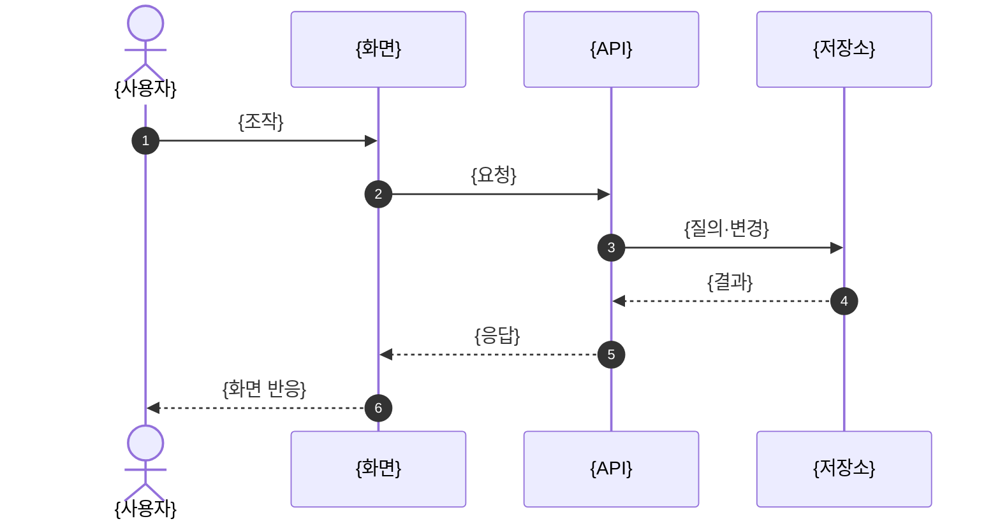

# 시나리오 풀 문서 양식 (TC 1개 = 10절)

> **SSOT:** 이 파일 (`test-scenario-full/references/template.md`)  
> **시나리오 1개 = 파일 1개.** 파일에는 `TS-*` 1개와 그 아래 모든 `TC-*`가 들어간다. **TC 1개마다 아래 10절**을 빠짐없이 쓴다.

저장: `docs/test-case/{YYYYMMDD_HHMMSS}_{TS_SLUG}_SCENARIO_FULL.md`

아래 골격을 그대로 복사해 `{…}`를 채운다. 절을 빼거나 합치지 않는다. 해당 없는 칸은 `해당 없음` 한 줄로 적는다.

---

````markdown
기준 SHA: `{short-sha}`

# {TS-ID} · {시나리오 제목 한 줄}

> 파일명: `docs/test-case/{YYYYMMDD_HHMMSS}_{TS_SLUG}_SCENARIO_FULL.md`  
> **실행하지 않은 문서다.** 판정 칸은 비어 있다. 실행하는 사람이 채운다.

## 시나리오 정보

| 항목 | 내용 |
|------|------|
| 시나리오 ID | `{TS-DOMAIN-FEATURE-001}` |
| 목적 | {이 시나리오가 보장하려는 것 한 문장} |
| 흐름 | {시작 → 성공 종료 한 문장} |
| 우선순위 | {P1 / P2 / P3} |
| 작성일 | {YYYY-MM-DD} |
| 근거 | {코드·문서 읽기 요약. **아직 실행하지 않았다.** 기획 미대조 시 명시} |
| 앞 시나리오 | {파일명 — 없으면 `없음`} |
| 이어지는 시나리오 | {파일명 — 없으면 `없음`} |

## 실행 전 준비

| 항목 | 내용 |
|------|------|
| 환경 | {로컬 / dev / test. 운영계 실행 금지} |
| 계정 | {역할·개수} |
| 데이터 | {필요 시드 데이터} |
| 데이터 변경 | {변경 대상·실행 후 원복 메모} |

## 구조

`TS-*` 1개 아래 `TC-*`만 1:N. 하위 `TS-*` 금지.

```
{TS-ID}   {시나리오 한 줄}
├─ {TC-ID}   {케이스 한 줄}
└─ {TC-ID}   {케이스 한 줄}
```

## 먼저 볼 케이스

코드·문서를 읽다가 문제 가능성이 보인 항목. 실행 전이므로 **결함으로 확정하지 않는다.** 없으면 `해당 없음`.

| TC | 코드·문서에서 보이는 것 |
|----|-------------------------|
| `{TC-ID}` | {의심 포인트. 불확실하면 `[확인 필요]`} |

---

## {TC-ID} · {제목 — 누가 / 무엇 / 조건 / 검증}

### 1. 기본 식별 정보

| 항목 | 내용 |
|------|------|
| TC ID | `{TC-ID}` |
| 시나리오 원본 TS | `{TS-ID}` |
| 유형 | {정상 / 예외 / 경계} |
| 우선순위 | {P1 / P2 / P3} |

### 2. 사전 조건

- 권한: {역할 계정으로 로그인된 상태}
- 진입 상태: {화면·API 호출 전 상태}
- 데이터 상태: {대출 건수·재고·설정 값 등}

### 3. 테스트 입력 데이터

| 필드 | 값 | 구분 |
|------|----|------|
| {필드} | {값} | {정상 값 / 경계값 / 경계값 초과 / 무효 값} |

(입력이 없으면 `해당 없음`)

### 4. 시퀀스 다이어그램

이 TC의 호출 순서를 Mermaid `sequenceDiagram`으로 그린다. `autonumber`를 켠다. 참여자는 실제 화면·API·저장소만 쓴다.



### 5. 시퀀스 다이어그램 기준 흐름표

4절의 화살표를 **한 행씩** 옮긴 표다. 번호는 다이어그램 `autonumber` 번호와 같다. 행을 새로 만들지 않고, 다이어그램에 없는 내용을 넣지 않는다.

| 번호 | 발신 | 수신 | 메시지 | 확인할 상태 |
|------|------|------|--------|-------------|
| 1 | {발신} | {수신} | {4절 메시지 그대로} | {이 시점에 관찰할 값 또는 화면} |

### 6. 검증 로직

관찰 지점별 **검증 규칙**을 적는다. 규칙은 참·거짓으로 판정할 수 있어야 한다. 확정 못 한 기준은 `[확인 필요]`.

| 번호 | 관찰 지점 | 검증 규칙 | 불충족 시 의미 |
|------|-----------|-----------|----------------|
| V1 | {API 응답·DB·화면} | {조건식} | {무엇이 잘못됐을 가능성} |

판정 규칙: 모든 V 항목이 충족되면 실행자가 Pass 후보로 기록한다. 하나라도 불충족이면 Fail 후보다. 판정 자체는 실행자가 한다.

### 7. 테스트 수행 절차

사용자가 실제로 하는 조작만 번호 목록으로 쓴다. 호출 순서·내부 처리는 4절·5절에 있으므로 여기서 반복하지 않는다.

1. {조작}
2. {조작}
3. {확인}

### 8. 예상 결과

6절 규칙을 모두 충족했을 때 **최종 화면·데이터의 스냅샷**만 쓴다. 6절 문장을 복사하지 않는다.

- 화면: {최종 UI 상태·문구. 문구가 확정되지 않으면 `[확인 필요]`}
- 데이터: {최종 저장 값}
- 그 밖: {없으면 `해당 없음`}

### 9. 실제 결과 및 판정

| 실제 결과 | 판정 |
|-----------|------|
| | |

(실행 전 문서 — 비움. 실행하는 사람이 채운다.)

### 10. 참조 API

| 메서드 | 경로 | 요청 | 성공 응답 | 근거 |
|--------|------|------|-----------|------|
| {METHOD} | {경로} | {요청 필드} | {상태 코드·응답 필드} | `{path}` {줄 범위} |

(UI만으로 끝나면 `해당 없음`. 호출하는 화면 조회 API도 포함한다.)

---

(TC가 여러 개면 위 `## {TC-ID}` 블록을 TC마다 같은 10절 형식으로 반복한다. 구조 트리의 순서와 같게 쓴다.)

## 근거

- `{path/to/file}` {줄번호 범위}

## 이번 범위에서 뺀 것

| 항목 | 이유 |
|------|------|
| {제외 흐름·화면} | {별도 TS·다음 시나리오 등} |

## 기존 문서와의 관계

{기존 `docs/test-case/` 산출·ID 충돌 회피·cross-ref. 없으면 `해당 없음`}
````

---

## 칸 채우는 요령

| 절 | 넣을 것 |
|----|---------|
| 1 기본 식별 | TC ID, 원본 TS, 유형(`정상` 해피 경로 / `예외` 실패·권한·오류 / `경계` 한계값·빈 값·최대·최소), 우선순위(`P1` 핵심·데이터 손상 위험 / `P2` 주요 분기 / `P3` 부가) |
| 2 사전 조건 | 역할 + 진입 상태 + 데이터 상태 |
| 3 입력 데이터 | 동등 분할·경계값에서 고른 대표값 |
| 4 시퀀스 다이어그램 | 실제 호출 순서. 화면 조작 → 화면 → API → 저장소 → 응답 |
| 5 흐름표 | 4절 화살표 1행 = 1 메시지. 번호·메시지 문구 동일 |
| 6 검증 로직 | 관찰 지점마다 참·거짓 규칙 1개 이상 |
| 7 수행 절차 | 사용자 조작만. 번호 목록 |
| 8 예상 결과 | 6절 충족 시 최종 화면·데이터 스냅샷 |
| 9 실제 결과·판정 | **비워 둔다** |
| 10 참조 API | 4절에서 호출하는 엔드포인트 + 근거 코드 위치 |

## 하지 말 것

- 한 파일에 `TS-*` 2개 이상
- TC 상세를 별도 파일·링크로만 남기기
- TC의 10절 중 하나를 빼거나 다른 절과 합치기
- 5절에 다이어그램에 없는 행 추가, 또는 4절과 같은 설명을 7절에 반복하기
- 9절 판정·실제 결과를 에이전트가 채우기
- 절차를 표 셀 안에 `<br>`로 넣기
